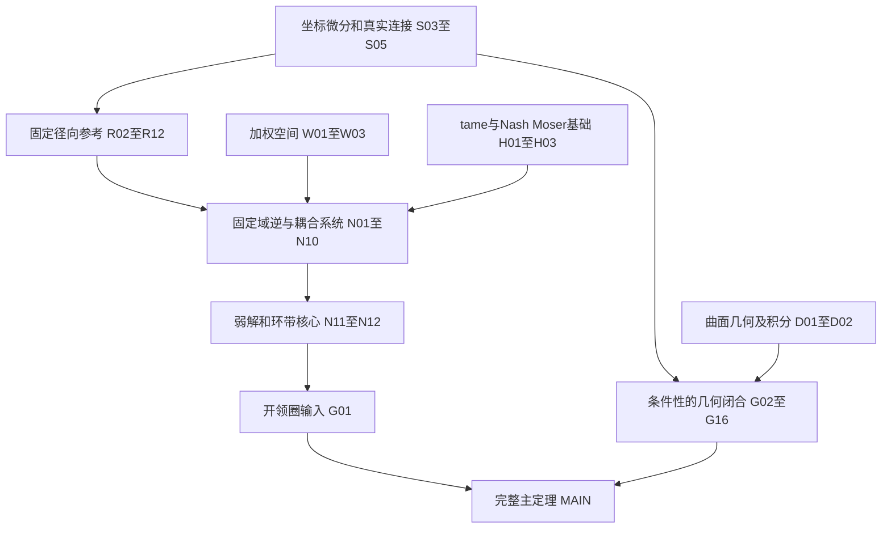

# 闭球面光滑周期等距弯曲形式化蓝图

本蓝图以完成论文 `thm:main` 的全部结论为目标，固定使用 Lean
4.35.0-rc3 和 mathlib 提交
`c55e6e786f49471c72fbddbec5415808896aec1e`。最初的蓝图轮次仅编写计划，
其证明快照保存在 `proof-baseline.json`；随后已开始实际 Lean 实现。

当前有 58 个节点，其中 55 个属于主定理依赖闭包，3 个是主定理之后的
加强旁支。已完成的 **S01、S02、R01 三个局部节点**对应坐标正定性、
系数行列式和实际径向换元；其余新增证明记录在部分实现节点的证据中。
公开显式定理的当前数量和完整映射见 `validation.json` 与 `NODES.md`。
`prop:scalar-core`、`prop:rad-fixed-theorem` 和最终主定理均尚未完成。
节点数不表示数学工作量比例。

当前证明证据固定于 `coordination/checkpoint-2026-11-11-radial-contract-wave.json`。
对应默认构建及按模块所有者审计通过的稳定源码，3240 条公开显式定理均唯一映射。
262 个项目模块的默认构建共 3690 项、零警告。公理审计覆盖 8966 个声明，
其中 6638 个是定理声明。264 个 Lean 文件合计 67989 行，包含陈述层、根入口和审计文件。
检查器逐文件核对哈希，并明确列出尚未计入本检查点的并行源码及负责人；其中
一些文件可能已有更晚的单模块通过记录。最终完成必须另跑
`python scripts/check_blueprint.py --all-current-sources`，不能靠排除草稿通过。
细分层的冻结合同保留原始展开义务，主层的`current_remaining_obligations`
记录最新实际断点，不改写那份独立审阅的历史合同。

- [逐节点陈述、证明提纲、论文定位和验收条件](NODES.md)
- [完整依赖图 Mermaid 源码](DEPENDENCIES.mmd)
- [机器可读的权威节点清单](manifest.json)
- [结构及源码对应检查结果](validation.json)
- [514 项细分任务及冻结源码的逐项验收](refinement/AUDIT.md)

细分层最近一次独立验收以 2026-11-11 台北时间 02:06:30 的冻结源码为准：
65 项完整完成、87 项部分完成、362 项尚未实现。后来的并行成果需另批验收。
这组任务数不表示数学工作量比例，也不自动升级本层 58 个里程碑的状态。

## 主定理的完整目标

取 `E3 = EuclideanSpace ℝ (Fin 3)`，取标准单位球面的子类型作为 `S2`，
采用 mathlib 已有的球面光滑结构。直接构造标准球面上的见证，
便足以满足论文“存在一个微分同胚于球面的曲面”的陈述。

需要构造光滑正定黎曼度量 `gΣ` 和联合光滑映射
`F : S2 × ℝ → E3`。记 `Fτ(x) = F(x,τ)`，要求：

| 原主定理要求 | 精确含义 | 对应节点 |
| --- | --- | --- |
| 光滑闭球面 | 定义域确为标准光滑 `S2`，其上度量光滑正定 | C00、G07 |
| 联合光滑族 | 在球面点和实参数的乘积上光滑 | G08 |
| 每个成员是嵌入 | 光滑 immersion 和 topological embedding 均成立，对所有实数 τ 有效 | G09 |
| 同一个内禀度量 | 对每个点及切向量 v,w，`⟪dFτ(v),dFτ(w)⟫ = gΣ(v,w)` | G09 |
| 一周期 | `∀ x τ, F(x,τ+1)=F(x,τ)` | G08 |
| 非全等像 | 存在 τ₁,τ₂，对所有欧氏 `AffineIsometryEquiv` A，`A '' range Fτ₁ ≠ range Fτ₂` | G13 |
| 固定内盘和补帽 | 内盘有非空内部，且位于图盘内部；补帽为图盘内部的补集。两者具有规定的圆盘拓扑，其上 `Fτ=F₀` | G07、G08 |
| 面积不变 | 实际像曲面的面积恒定 | D02、G14 |
| 围成体积不变 | 实际有界内部区域的 Lebesgue 体积恒定 | G15 |
| 总有向平均曲率不变 | 向外单位法向、`H=(k₁+k₂)/2` 下，实际曲面积分 `∫H dA` 恒定 | D01、D02、G16 |

优先定义 `gΣ = F₀*δ`，再证明每个 `Fτ` 的拉回度量相同。
环境空间弦长的 `Isometry Fτ` 不能替代上述切空间内积等式。
参数化映射不同也不能替代像集非全等。面积、体积和总平均曲率必须有标准
几何或测度定义，不能以常值别名替代。

完整目标类型见 [MainGeometry.lean](../ContinuousFlexibility/Statements/MainGeometry.lean)。
[陈述清单](../ContinuousFlexibility/Statements/manifest.json)记录了 58 个闭合的
Lean 命题、手稿位置和验收条件。陈述层的独立构建和公理审计已通过：
汇总构建 3501 jobs、零警告，只使用三个标准公理。
定义目标类型不构造 `ClosedBending` 或 `FlatAnnularCore` 的见证，
`MAIN` 的存在性结论仍未证明。

## 两个存在性引擎与组装路线

下图压缩了多步依赖；精确的直接依赖以 `manifest.json` 为准。



几何引擎已编译为
[`mainStatement_of_flatAnnularCore`](../ContinuousFlexibility/Contracts/SphereClosedBending.lean)：
给定一个实际环带核心，即可构造满足完整目标的同一个球面族。分析引擎仍须构造
一个实际 `FlatAnnularCore`，才能实例化这条几何闭合并得到无条件 `MAIN`。

G02 及后续几何定理中的参数必须一致：同一个环带输入 A、同一个归一化发展 P、
同一个标记补帽和同一个相位族 Fτ。不得在不同结论中各自选择无法统一的见证。

## 四个需要先冻结的接口

`FlatAnnularCore` 和 `AnnularSolution` 已在 `Contracts/Annular.lean` 编译，
后者由前者实际扩大构造；这不证明前者有实例。径向参考和 `ClosedBending`
的完整目标规格另写在 `Statements/`，目前尚无其完整见证。新增输出 `IsometricGraphDevelopment`
由同一个 Core 实际构造，不作为分析端的额外假设。

### FlatAnnularCore

分析端输出一个固定的 `0<a<b` 及实际光滑函数 `w,z`，满足：

- `w>0` 在原环带内部，两端均具有全阶光滑零延拓。
- `z` 对角变量为实偶、π 周期；非径向用两个角向取值不相等表达。
- `z` 在两端分别具有常值平坦延拓，左右常数允许不同。
- `g=(1+w²)dr²+r²dθ²`，余度量正定，真实连接残差为零。
- 全部角向混合 jets 及所需参数导数具有实际延拓证明。

主定理只需要固定一个非零构造参数 `q` 后的这个对象。
完整光滑 `q` 分支是论文路线提供的较强输出；后来的弯曲参数是独立的 `τ`。

### AnnularSolution

G01 将核心扩大成稍大的环带，得到真实开领圈。在领圈上 `w=0`，
`z=cL` 或 `cR`；余度量正定且平坦，半转对称和非径向性保留。

扩大后的 `w` 不可能在整个扩大环带上严格正，因为开领圈上它等于零。
严格正性只用于原核心。这个区别必须保留在 Lean 字段中。

当前已证明从 Core 构造全局光滑 Cartesian 高度、正定余度量、真实闭连接、
外部归一化且 Jacobian 为正的全局双光滑平面发展及 E3 等距图嵌入。
封帽取扩大后的外半径 `R>b`，才有附着边界内侧的真实开水平领圈。
发展唯一性、奇性、中心固定及内闭盘中心旋转均已从实际导数和同一 Core 证明。
同一发展还给出联合光滑、一周期、保持同一度量并逐点固定内外区域的图族；
闭图盘像确为原图盘像的真实环境轴旋转。同一发展上的实际固定帽与标准球面
光滑拼接已通过。整球非全等、实际标记内域与向外法向，以及三项不变量
已在同一族上组装；核心存在性仍待完成。

为减少一般曲率库的前置工作，主链可使用明确高度函数的 Cartan 结构方程：
真实坐标残差为零给出闭连接，旋转余标架后积分得到平面发展。
必须证明该过程产生实际局部等距，不能把“平坦”定义成未经识别的任意谓词。
对任意度量的一般 Darboux/Gauss 公式可另作库扩展；它不是这个主定理的必需前置。

### RadialReference

须由 R12 真正构造，不能留作最终主定理的假设：

- 同一个正的端点平坦 `w*`，内部转点简单；同一个非零二模端点平坦 `φ*`。
- 空间限定为实偶且 π 周期的角函数，即偶数余弦模。
  二模核为 `ℝφ*`，其余偶频 `j≥4` 的自然端点核为零。
- 每个负区间的旅行角满足全部正频率的小除数下界。
  谱非共振与特征返回非共振分别证明。
- 真实边框列 `g*=L'₂,w*[w*χ*]φ*`，归一化 `∫g*φ*dr=1`，以及对应行 `ℓ*`。
- 兼容源满足 `∫⟨f⟩dr=0`；右端高度归零，左端差常数作为自由标量。
- 目标分布图域上的双侧逆、光滑 core 闭包识别、配对和估计。
- 主定理固定 `β=3/4` 及一个 `0<ε<1/4`；
  `β−ε,β,β+ε` 必须使用同一个几何、边框及自然端点逆。

R12 使用 §4 的源范数及 §6 的分布图域。
§7 的物理加权空间 W02 是另一层构造，不能反过来作为 R12 的证明前提。
W01 所需实际尺度、轮廓 jets 从 R05 的统一单元估计取得。
这样避免“先有参考逆才能建空间、先有空间才能证参考逆”的循环。

### ClosedBending

输出标准 `S2`、实际嵌入族、固定区域、度量和三项积分不变量的全部见证。
面积和平均曲率通过 D01/D02 的曲面几何及换元接口定义；体积通过 G15
构造的实际内部区域识别。最终定理应无剩余的环带存在性、径向参考存在性、
逆算子存在性或 Hamilton 定理结论假设。

## 必须明确的量词和选择次序

1. **所有频率同时选高。** R07 必须得到 `∃(σ_n), ∀j, ...`。
   有限立方体估计、闭条件和紧性极限缺一不可。
2. **同一几何上的两个指数。** 不同指数分别选择轮廓不能支持 §8 的双权 block
   论证。原文对全部紧指数区间的加强另列 X01。
3. **同一低阶邻域。** 所需量词为
   `∃b₀ ε₀ d*, ∀s, ∃C_s, ∀x, n_b₀(x)<ε₀ → ...`。
   不得每个 `s` 重新缩小邻域。
4. **同一参数区间。** N11 的全部阶数要共用一个 `q₀>0`。
   `∀s, ∃q_s>0` 不足以选出一个非零 `q` 并得到光滑高度。
5. **先有界再做 Neumann。** N06 在同一个 `V_{0,b}` 上、N09 在同一个 `Bβ`
   上证明有界自同态和小范数，然后才反演。导数损失估计不能代替这个前提。
6. **两个独立残差。** N10 的 `Q(r,y)` 必须在独立变量上真正双线性并保持
   源兼容，不能只给代入 `r=R(x,q)` 后的二次大小估计。
7. **源和测度。** 原物理源是 `dr dθ`，Hilbert 谱测度、材料坐标测度以及
   canonical source 的 Jacobian 需要显式转换。R01 已证明的非齐次源因子
   不能在全局 Green 或分布方程中丢掉。
8. **冻结参数。** 将 `M₀`、模型间隔、初始 `N`、cut/head 长度、`M₁`、
   固定低阶 `b₀` 和损失 `d*` 的允许依赖逐条登记。后续若要求重选已经冻结的
   几何，必须回到相应数学节点核查；不能因输出阶数增加而暗中重选。

还需区分两次算子修正：S05 只改角向系数，保持全局法向通量；N03 的返回修正
保持法向主系数 a，却通常改变混合系数 b，因此只在修正支持外及界面保持原通量。
N04 的全阶物理 jet 匹配也要使用分片方程和源的光滑匹配，不能由值与一阶
conormal 传递条件单独推出。N01 只先给原系数和普通流的估计，根正则坐标与
三阶除后的系数界留在 N04，避免隐式循环。

## 几何路线的具体选择

- **标准球面作为定义域。** 用立体投影的扩大半球圆盘坐标和相同开领圈拼接。
  不用在 equator 处径向导数退化的半球 `xy` 投影。
- **发展从局部到全局。** 填盘消 holonomy、归一化发展、奇性消平移，
  再以 proper/local diffeomorphism/covering 论证得到全局圆盘微分同胚。
- **边界刚性采用实际 ODE 传播。** G10 从真实度量等式推导 Hessian/连接变换式，
  沿直线比较映射及其一阶导数，构造统一 Lipschitz 界后调用本地 ODE 唯一性。
  相关变换式和传播尚未证明；径向距离公式路线保留作后备。
- **非全等需要第二个步骤。** 盘像不恒定仅是 G11；G12 的曲率标记给最多四个
  仿射等距候选，G13 再用连续性推出两个闭像非全等，覆盖环境反射。
- **体积先识别实际内部。** G15 证明显式区域的边界、内外连通关系和外法向，
  随后才计算体积。这个结果也服务于 G12 和 G16 的向外法向。

## 固定 mathlib 提交中的可复用基础

以下是本轮实际查看本地源码得到的定位，不代表应用桥接已经完成。

| 基础 | 源码定位 | 仍须证明或适配 |
| --- | --- | --- |
| 标准球面图册 | `Geometry/Manifold/Instances/Sphere.lean`，`stereographic` 等 | 具体圆盘参数和领圈适配 |
| 光滑嵌入 | `Geometry/Manifold/SmoothEmbedding.lean`，`Manifold.IsSmoothEmbedding` | 实际构造的 immersion 和全局 embedding |
| 光滑黎曼度量 | `Geometry/Manifold/VectorBundle/Riemannian.lean`，`ContMDiffRiemannianMetric` | 拉回度量及本文曲面几何桥接 |
| 凸集上的 Poincaré 引理 | `MeasureTheory/Integral/CurveIntegral/Poincare.lean` | 全局余标架、连接、归一化 primitive |
| proper/covering 基础 | `Topology/Maps/Proper/Basic.lean`，`Topology/Covering/Basic.lean` | 有限纤维、单层和光滑逆的组合 |
| 半范数族拓扑 | `Analysis/LocallyConvex/WithSeminorms.lean` | 本文完备空间、tame calculus、平滑算子 |
| 圆 Fourier L² 基础 | `Analysis/Fourier/AddCircle.lean` | 偶半周期 sector、加权序列和小除数损失 |
| Bessel potential/Sobolev | `Analysis/Distribution/Sobolev.lean`，`Analysis/FunctionalSpaces/SobolevInequality.lean` | 材料圆柱的混合范数、trace、乘积和分布拼接域 |
| Banach 小扰动逆 | `Analysis/Normed/Ring/Units.lean`，`NormedRing.inverse_one_sub` 等 | 同空间有界性、小范数及PDE域识别 |

针对当前源码的 `Nash–Moser`、`TameFrechet`、`SmoothTame` 和相关关键词检索，
尚未定位到可直接替代 H01/H02/H03 的结果。因此这三项列为必须实现或适配的
真实基础任务。普通 `Analysis/Calculus/Implicit.lean` 的 Banach 隐函数定理
不自动提供这里的导数损失结论。

曲面形算子、Gaussian 曲率、总有向平均曲率及其积分运输也必须落实到实际定义
和证明。D01、D02 单列这些工作，避免把它们隐藏在“旋转显然保持积分”中。

## 实施顺序和验收门槛

| 关口 | 下一步的实质输出 | 进入后续阶段的条件 |
| --- | --- | --- |
| A | 将 C00 的目标语义和接口落实为精确 Lean 类型；完成 S03–S05 的真实微分 | 点态计算与真实连接、实际变分及兼容源逐项连接 |
| B | 并行开展 R02–R06、H01/W01–W03、条件性 G02–G05 和 D01 | 优先暴露谱实现、连续深尾域、tame 定义和曲面二阶几何的库缺口 |
| C | 完成 R07–R12，得到实际固定径向参考 | 同时选高、匹配逆、双权估计及双侧图域全部闭合 |
| D | 完成 N01–N10、H02/H03 | 固定域基本空间反演、精确双线性误差以及真正的 Nash–Moser 存在定理 |
| E | 完成 N11/N12/G01；几何分支完成 G06–G16 | 弱解真实提供开领圈输入，且嵌入、非全等和三项不变量均有证明 |
| F | MAIN 无条件组装与逐项完成审计 | 主定理声明覆盖全部原结论，`lake build` 和实际主定理的公理依赖审计通过 |

R06、R07、R11/R12、N04–N06 和 H03 是应尽早展开的高风险关口。
这些标记表示需要优先做精确数学核查和库适配，并不表示已发现论文错误。

X01 的全指数范围、X02 的双倍端点权/二次控制以及 X03 的附录障碍不在
首次主定理闭合的前置链上。**N12 的弱控制和全阶端点延拓仍必须实际证明**，
不能因第 10 节的加强估计后置而略过。

## 检查和后续维护

当前实现可重复执行：

```powershell
python scripts/check_blueprint.py
lake build
```

蓝图检查验证节点 ID、直接依赖无环且无悬空、主定理依赖闭包、论文文件/标签/行号、
全部当前公开显式定理的唯一映射，以及固定工具链和依赖提交。
它不会证明任何待做节点的数学结论。

后续实现时编辑 `manifest.json` 中的状态、真实 Lean 对应和依赖，然后运行：

```powershell
python scripts/check_blueprint.py --write
python scripts/check_blueprint.py
lake build
```

`proof-baseline.json` 是本轮“只做蓝图”的历史快照；开始新增证明后，
不再使用 `--check-proof-baseline` 要求历史文件保持原样。
检查器仍会要求所有当前公开显式定理被准确映射；私有辅助证明也参与 Lean 公理审计。
历史快照的差异单列为信息，不是当前实现的失败检查。目标文件路径标为拟建的节点，
不会因为清单里出现了名字而被当作已形式化。

最终完成审计要查看 `MAIN` 实际 Lean 类型及其全部依赖，逐条核对上面的原主定理
要求。现有构建、公理审计和蓝图结构检查均不能代替这个最终审计。
